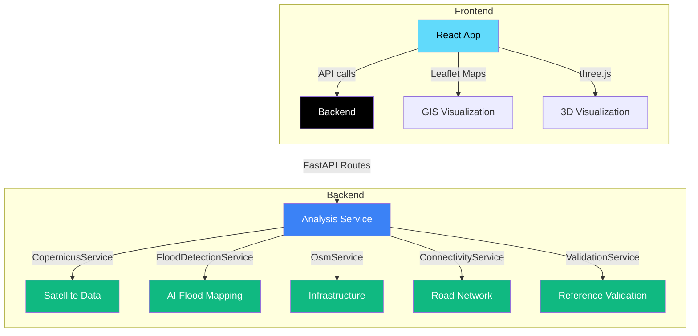

# AQUASCOPE — Satellite-Based Flood Damage Mapping and Geospatial Analysis

<div align="center">

[](https://opensource.org/licenses/MIT)
[](https://www.python.org/)
[](https://fastapi.tiangolo.com/)
[React](https://img.shields.io/badge/react-18.x-61DAFB.svg)
[Vite](https://img.shields.io/badge/vite-5.4+-646CFF.svg)

</div>

---

## Project Overview

**AQUASCOPE** is a satellite-powered flood impact mapping and disaster intelligence platform. It provides geospatial analysis of flood events using Sentinel-1 satellite imagery, AI-driven flood segmentation, and infrastructure impact assessment. The platform is designed to integrate real Copernicus Data Space API data with deterministic mock fallbacks for demonstration and development purposes.

## Problem Statement

Flood events cause significant damage to infrastructure, disrupt road connectivity, and displace settlements. Rapid assessment of flood extents and affected assets is critical for emergency response and recovery planning. Traditional methods rely on optical imagery, which is limited by cloud cover. AQUASCOPE addresses this by using Synthetic Aperture Radar (SAR) from Sentinel-1 satellites, which penetrates clouds and provides all-weather monitoring capability.

## Key Features

- **Sentinel-1 Scene Discovery**: Automatic discovery of pre-event, co-event, and post-event Sentinel-1 scenes via the Copernicus Data Space API
- **AI Flood Mapping**: Siamese SNUNet-style change detection on preprocessed Sentinel-1 data to generate flood probability maps and binary flood masks
- **Infrastructure Impact Analysis**: Simulation of roads, buildings, and bridges potentially affected by flooding
- **Road Connectivity Analysis**: Assessment of which settlements become potentially road-disconnected due to flood impacts
- **Validation against Reference Data**: Comparison of model results against EMSR927 / UNOSAT reference mapping
- **Source Tracking**: All results clearly track whether data is REAL (from live APIs) or FALLBACK (deterministic mock)
- **Demo Mode**: Fully functional interface using simulated data for development and testing

## Current Implementation Status

| Feature | Status | Details |
| --- | --- | --- |
| Sentinel-1 scene discovery | Mock/Demo | Mock service with REAL/FALLBACK source tracking — deterministic fallback when real API unavailable |
| Sentinel-1 preprocessing | Mock/Demo | Mock preprocessing pipeline — falls back to deterministic mock when real data/credentials unavailable |
| AI flood mapping | Mock/Demo | Mock flood detection with configurable threshold — simulated AI outcomes for interface validation |
| Infrastructure impact analysis | Mock/Demo | Mock OSM/ohsome overlay — simulated infrastructure data for demo interface |
| Road connectivity analysis | Mock/Demo | Mock NetworkX-based connectivity — simulated road graph for demo interface |
| Validation against references | Mock/Demo | Mock EMSR927 comparison — simulated reference data for interface validation |
| Real Copernicus API integration | Planned | Requires API credentials and network access |
| Real OSM/ohsome queries | Planned | Requires network access and ohsome API integration |
| Real NetworkX connectivity | Planned | Requires road graph data and NetworkX integration |
| Three.js 3D visualization | Implemented | Demo scene rendering — real Three.js code with mock data input |
| Frontend user interface | Implemented | React + Vite + Leaflet dashboard — real frontend code with mock data |

## Frontend Technology Stack

- **React 18** with functional components and hooks
- **Vite** build tool and dev server
- **React Router** for client-side routing
- **Leaflet** + **react-leaflet** for interactive maps
- **Recharts** for data visualization
- **Framer Motion** for animations
- **three.js** + **@react-three/fiber** for 3D content
- **JSPDF** for report generation
- **TailwindCSS** with PostCSS for styling

## Backend Technology Stack

- **FastAPI** (Python 3.11+) as the API framework
- **Pydantic** for data validation and schema management
- **httpx** for async HTTP requests to Copernicus Data Space API
- **Python-dotenv** for environment variable loading
- Structured mock services with REAL/FALLBACK source tracking

## System Architecture



### Pipeline Flow

1. **Data Acquisition**: User provides location, AOI, and event date → Backend discovers Sentinel-1 scenes
2. **Preprocessing**: Sentinel-1 before/after pair is radiometrically and terrain-calibrated, aligned to common CRS
3. **AI Flood Mapping**: Preprocessed pair feeds into change-detection model → Flood probability map → Binary mask with threshold
4. **Infrastructure Impact**: Flood mask intersected with OSM data → Potentially affected roads, buildings, bridges
5. **Connectivity Analysis**: Road network graph modified by flood mask → Potentially road-disconnected settlements
6. **Validation**: Results compared against EMSR927 reference mapping → IoU, Dice, Precision, Recall, F1 metrics

## Project Folder Structure

```
AQUASCOPE/
├── README.md                 # Project documentation (this file)
├── index.html               # HTML entry point
├── package.json             # Frontend dependencies
├── vite.config.ts           # Vite configuration
├── tsconfig.json            # TypeScript configuration
├── postcss.config.js        # PostCSS configuration
├── tailwind.config.js       # Tailwind CSS configuration
├── dist/                    # Frontend build output
├── node_modules/            # Frontend dependencies
├── backend/                 # Backend API
│   ├── app/
│   │   ├── __init__.py
│   │   ├── main.py          # FastAPI application entry point
│   │   ├── api/             # API routers
│   │   │   ├── analysis.py
│   │   │   ├── satellite.py
│   │   │   ├── infrastructure.py
│ │   │   └── connectivity.py
│   │   ├── core/            # Core configuration
│   │   │   └── config.py
│   │   ├── schemas/           # Pydantic API schemas
│   │   │   ├── analysis.py
│   │   │   ├── results.py
│   │   │   └── satellite.py
│   │   └── services/          # Business logic services
│   │       ├── __init__.py
│   │       ├── analysis_service.py    # Pipeline orchestrator
│   │       ├── satellite_service.py   # Sentinel-1 discovery
│   │       ├── flood_detection_service.py  # AI flood mapping
│   │       ├── flood_mask_service.py   # Mask generation + area calculation
│   │       ├── infrastructure_service.py  # OSM/ohsome overlay
│   │       ├── connectivity_service.py   # Road connectivity
│   │       ├── preprocessing_service.py  # Sentinel-1 preprocessing
│   │       └── validation_service.py     # EMSR927 validation
│   ├── data/
│   │   └── demo_scenario.json       # Demo scenario data
│   ├── requirements.txt  # Python dependencies
│   ├── .env.example      # Environment variables template
│   └── .gitignore        # Git ignore rules
```

## Windows Prerequisites

### System Requirements

- **Operating System**: Windows 10 or Windows 11
- **Python**: 3.11 or 3.12 (64-bit)
- **Node.js**: 18.x or 20.x (LTS)
- **Git**: 2.30+ for version control

### Python Dependencies (Backend)

The backend requires the following packages. Most can be installed via `pip`:

```bash
pip install -r backend/requirements.txt
```

The `requirements.txt` includes:

- `fastapi>=0.115,<1.0.0`
- `uvicorn>=0.30,<1.0.0` (ASGI server)
- `pydantic>=2.8,<3.0.0`
- `python-dotenv>=1.0,<2.0.0`
- `httpx>=0.27,<1.0.0` (async HTTP client)
- `pytest>=8.0,<9.0.0` (testing)
- `networkx` (for road graph connectivity — optional, installed with connectivity service)
- `shapely` (for geometry operations — optional, installed with infrastructure service)

### Node.js Dependencies (Frontend)

```bash
npm install
# or
yarn install
```

The `package.json` includes React, Leaflet, Recharts, three.js, and TailwindCSS dependencies.

## Installation

### Backend Setup

1. **Clone the repository** (or extract the project folder)

2. **Create a virtual environment** (recommended):

   ```powershell
   # Navigate to backend directory
   cd backend

   # Create virtual environment
   python -m venv .venv

   # Activate virtual environment
   .venv\Scripts\Activate.ps1

   # Install dependencies
   pip install -r requirements.txt
   ```

3. **Environment configuration**:

   ```powershell
   # Copy the example environment file
   copy .env.example .env

   # Edit .env with your credentials (optional for mock mode)
   notepad .env
   ```

   The `.env.example` file shows that all credentials are optional — the application runs fully in mock mode without any API keys.

4. **Start the backend server**:

   ```powershell
   # From the backend directory
   uvicorn app.main:app --reload --host 0.0.0.0 --port 8000
   ```

   The backend will be available at `http://127.0.0.1:8000`.

### Frontend Setup

1. **Navigate to the project root**:

   ```powershell
   # From anywhere, go to project root
   cd "C:\Users\chhab\OneDrive\Documents\New OpenCode Project"
   ```

2. **Install npm dependencies**:

   ```powershell
   npm install
   ```

3. **Start the frontend development server**:

   ```powershell
   npm run dev
   ```

   The frontend will be available at `http://localhost:5173` (or the port specified in `vite.config.ts`).

### Running the Full Application

1. Start the backend server (as above)
2. Start the frontend development server (as above)
3. The frontend will connect to the backend at `http://localhost:8000` by default
4. Use the web interface to run flood analyses with mock/demo data

## Backend API Endpoints

All endpoints are prefixed with `/api/v1` (configured in `backend/app/core/config.py`).

### Health Check

```http
GET /
```

Returns service root information:

```json
{
  "service": "AQUASCOPE Backend",
  "version": "0.1.0",
  "status": "running",
  "data_source": "DEMO / SIMULATED DATA",
  "docs": "/docs",
  "health": "/api/v1/analysis/health",
  "run_analysis": "/api/v1/analysis/run"
}
```

```http
GET /api/v1/analysis/health
```

Returns analysis API health status:

```json
{
  "status": "healthy",
  "service": "AQUASCOPE Analysis API",
  "version": "0.1.0",
  "data_source": "DEMO / SIMULATED DATA"
}
```

### Run Flood Analysis

```http
POST /api/v1/analysis/run
```

**Request body:**

```json
{
  "location": "Trishuli, Nepal",
  "aoi": {
    "type": "Polygon",
    "coordinates": [[[85.239, 27.851], [85.2348, 27.8594], ...]]
  },
  "event_date": "2026-08-26"
}
```

**Response:** Complete `AnalysisResult` with all pipeline stages, source tracking, and limitations.

### Satellite Data Status

```http
GET /api/v1/satellite/status
```

Returns satellite service status with source tracking (REAL vs FALLBACK).

```http
POST /api/v1/satellite/discover
```

Discover Sentinel-1 scenes for a given event date and AOI.

### Infrastructure Status

```http
GET /api/v1/infrastructure/status
```

Returns infrastructure analysis service status (always mock in current stage).

### Connectivity Status

```http
GET /api/v1/connectivity/status
```

Returns road connectivity service status (always mock in current stage).

## Demo Mode, Mock Data, and Fallback Behavior

### How Demo Mode Works

The application is designed to work immediately without any external dependencies. When real API credentials or network access is unavailable, all services automatically fall back to deterministic mock implementations that produce consistent, structured results.

### Mock Data Sources

- **Satellite scenes**: Deterministic Sentinel-1 scene generation with configurable relative orbit 143 (ascending pass)
- **Flood mapping**: Simulated AI flood detection with user-configurable threshold (default: 0.52)
- **Infrastructure**: Pre-simulated OSM data for the Trishuli, Nepal AOI
- **Connectivity**: Pre-simulated road network and settlement data
- **Validation**: Pre-simulated EMSR927 reference comparison

### Source Tracking

All API results include a `source` field that indicates data provenance:

- `"REAL"` — Data resolved by the real Copernicus Data Space API or other live services
- `"FALLBACK"` — Data resolved by the deterministic mock service

This tracking is propagated through every stage of the pipeline, from satellite scene discovery through to final validation results.

### Limitations — Important Scientific Disclaimers

**Read carefully before relying on results:**

1. **All values are DEMO / SIMULATED DATA**: The mock services produce deterministic outputs for interface validation. They contain **no real satellite observations**, real flood extents, or real damage assessments.

2. **Flood overlap does not imply destruction**: An asset that intersects the flood mask is flagged as "potentially affected" but is **NOT labeled destroyed**. The system reports potential exposure, not actual damage.

3. **Terrain uncertainty**: Steep slopes in mountainous corridors cause SAR layover and shadow effects, reducing detection reliability. Urban areas with dense building cover may under-report flood extent due to double-bounce scattering.

4. **Reference data limitations**: EMSR927 / UNOSAT reference mapping is used for validation only and is not ground truth. It has its own production timeline and mapping conventions.

5. **AOI area calculations**: The bounding-box-based area approximation is **not scientifically accurate** for geospatial analysis. Proper area calculation requires rasterio/GDAL with a projected CRS.

6. **Validation metrics without real reference**: When no EMSR927 reference data is available, all metrics (IoU, Dice, Precision, Recall, F1) are zero with explicit interpretation noting the absence of real reference data.

7. **No operational use**: Results are preliminary and should be verified with local field information before any operational use.

8. **Co-event scene availability**: The mock service simulates a common scenario where the co-event (event-date) scene is unavailable, requiring fallback to pre-event or post-event scenes.

## Data Sources and Geospatial Analysis Workflow

### Intended Workflow

1. **Define AOI**: Speculate the Area of Interest as a GeoJSON polygon, or let the backend derive a default corridor around the specified location.

2. **Specify event date**: Provide the flood event date in `YYYY-MM-DD` format.

3. **Satellite scene discovery**: Backend queries the Copernicus Data Space API (or mock) for suitable Sentinel-1 scenes:
   - Pre-event scene: Acquired 5-20 days before the event
   - Co-event scene: Acquired on the event date (often unavailable due to downlink gaps)
   - Post-event scene: Acquired 0-3 days after the event

4. **Preprocessing**: Pre-event and post-event Sentinel-1 GRD scenes are:
   - Orbit-corrected
   - Radiometrically calibrated (to sigma-nought)
   - Terrain-corrected (using Copernicus DEM if available)
   - Clipped to AOI bounds
   - Aligned to common CRS and resolution

5. **AI flood mapping**: Preprocessed before/after pair feeds into the change-detection model:
   - Siamese SNUNet-style architecture computes pixel-wise change probability
   - Validation-selected threshold (default: 0.52) converts probabilities to binary mask
   - Flood mask generated with area calculations and confidence breakdown

6. **Infrastructure overlay**: Binary flood mask intersected with OpenStreetMap data:
   - Potentially affected road length (km)
   - Potentially affected building count
   - Potentially affected bridge count

7. **Connectivity analysis**: Road network graph modified by flooded segments:
   - Recalculated routes to settlements and hospitals
   - Identification of potentially road-disconnected settlements
   - Alternative route availability assessment

8. **Validation**: Results compared against EMSR927 / UNOSAT reference mapping:
   - IoU, Dice, Precision, Recall, F1 metrics
   - Area comparison and interpretation

### Geospatial Limitations

- All mock data uses **EPSG:4326** (WGS84) coordinate reference system
- Area calculations use **bounding box approximations** — not suitable for precise geospatial analysis
- Real implementation would require **rasterio/GDAL** for proper GeoTIFF I/O, reprojection, and equal-area calculations
- Sentinel-1 GRD data backscatter values are affected by: incidence angle, terrain slope, land cover, and soil moisture
- The mock threshold (0.52) is **demonstration-only** and should be validated for real-world use cases

## Roadmap

| Phase | Goal | Status |
| --- | --- | --- |
| **Phase 1** | Foundation with mock services | ✅ Completed |
| **Phase 2** | Real Copernicus Data Space API integration | 🚧 In progress (requires API credentials) |
| **Phase 3** | Real OSM/ohsome infrastructure queries | 📋 Planned |
| **Phase 4** | PyTorch flood segmentation model integration | 📋 Planned |
| **Phase 5** | NetworkX road graph connectivity analysis | 📋 Planned |
| **Phase 6** | EMSR927 / UNOSAT real reference validation | 📋 Planned |
| **Phase 7** | 3D visualization of flood extents in three.js | ✅ Completed |
| **Phase 8** | Report generation with JSPDF | ✅ Completed |

### Near-term Priorities

1. Add real Copernicus Data Space API integration with proper authentication
2. Implement real OSM/ohsome infrastructure queries with timeout and graceful fallback
3. Integrate PyTorch-based flood segmentation model (Siamese/SNUNet)
4. Add NetworkX road network analysis with real graph data
5. Implement real EMSR927 reference comparison with proper alignment
6. Add proper geospatial area calculations with rasterio and projected CRS

## Troubleshooting

### Common Issues

| Symptom | Cause | Solution |
| --- | --- | --- |
| Backend won't start | Missing Python dependencies | Run `pip install -r backend/requirements.txt` |
| Frontend won't compile | Missing Node.js dependencies | Run `npm install` in the project root |
| CORS errors | Frontend running on different port | Configure `CORS_ORIGINS` in `.env` or run both on default ports |
| Satellite discovery returns no scenes | No real API credentials | The mock fallback will automatically engage |
| Analysis returns all zeros | Mock data behavior | This is expected in demo mode — no real satellite data is used |
| Leaflet map not displaying | CSS not loaded | Ensure `leaflet/dist/leaflet.css` is imported in `main.tsx` |
| TypeScript errors | Type mismatches | Run `npm run typecheck` to identify issues |

### Getting Unusual Results

- If flood extents seem unexpectedly large/small: The mock threshold (0.52) is configurable. Adjust the `threshold` field in the `AnalysisRequest` if your API supports it.
- If infrastructure counts seem high/low: The mock infrastructure data is scenario-specific (Trishuli, Nepal). Real OSM queries would provide location-specific data.
- If validation metrics are all zero: This is normal when no real EMSR927 reference data is available. The mock service always produces structured results with explicit interpretation.

## Contribution Guidelines

### Development Setup

1. **Fork the repository** and create a branch from `main`:
   ```bash
   git checkout -b feature/your-feature-name
   ```

2. **Follow the existing code style**:
   - Python: Follow PEP 8, use type annotations, docstrings for all public functions
   - TypeScript/React: Use functional components, hooks, and the existing patterns in `src/`
   - All new services should follow the `Mock/Real` pattern established in the codebase

3. **Run existing tests** before making changes:
   ```bash
   # Backend tests
   cd backend
   pytest

   # Frontend typecheck
   npm run typecheck
   ```

4. **Ensure REAL/FALLBACK tracking is preserved**:
   - Any new real service must produce output compatible with the existing schemas
   - Source field must be set appropriately ("REAL" or "FALLBACK")
   - Mock fallback must maintain the same output structure

5. **Add demo scenario data** if adding new functionality:
   - Update `backend/data/demo_scenario.json` with appropriate mock data
   - Ensure all new schema fields have defaults in the mock services

6. **Update this README** if adding new features or changing existing ones

### Pull Request Process

1. Ensure all tests pass
2. Update the README if API endpoints or functionality changes
3. Ensure the `source` tracking field is properly set on all new results
4. Document any scientific limitations introduced by new features
5. Submit the pull request with a clear description of changes

### Code of Conduct

- Scientific claims must be accurately represented
- Mock/fake results must be clearly labeled as such
- No claim that affected infrastructure is confirmed destroyed
- All references to real data must distinguish between REAL and FALLBACK sources
- Contributions that introduce real API integrations must include proper credential handling and error boundaries

## License

This project is licensed under the **MIT License** — see the [LICENSE](LICENSE) file for details.

**Full license text:**

```
MIT License

Copyright (c) 2026 AQUASCOPE

Permission is hereby granted, free of charge, to any person obtaining a copy
of this software and associated documentation files (the "Software"), to deal
in the Software without restriction, including without limitation the rights
to use, copy, modify, merge, publish, distribute, sublicense, and/or sell
copies of the Software, and to permit persons to whom the Software is
furnished to do so, subject to the following conditions:

The above copyright notice and this permission notice shall be included in all
copies or substantial portions of the Software.

THE SOFTWARE IS PROVIDED "AS IS", WITHOUT WARRANTY OF ANY KIND, EXPRESS OR
IMPLIED, INCLUDING BUT NOT LIMITED TO THE WARRANTIES OF MERCHANTABILITY,
FITNESS FOR A PARTICULAR PURPOSE AND NONINFRINGEMENT. IN NO EVENT SHALL THE
AUTHORS OR COPYRIGHT HOLDERS BE LIABLE FOR ANY CLAIM, DAMAGES OR OTHER
LIABILITY, WHETHER IN AN ACTION OF CONTRACT, TORT OR OTHERWISE, ARISING FROM,
OUT OF OR IN CONNECTION WITH THE SOFTWARE OR THE USE OR OTHER DEALINGS IN THE
SOFTWARE.
```

> **Note**: The license file (LICENSE) should be created at the project root. If it does not exist, the above text represents the intended license for this project.

---

## Scientific Integrity Statement

AQUASCOPE is designed as a **development and demonstration platform**. All mock/fallback services are clearly labeled and produce deterministic outputs for interface validation. The system explicitly avoids:

- Presenting mock results as real satellite-derived findings
- Claiming that potentially affected infrastructure is confirmed destroyed
- Making operational assertions without REAL data source verification
- Generating results that could be misinterpreted as ground truth

Users must verify all results with local field information and real satellite data before any operational or decision-making use. The demo mode is intended for interface validation, algorithm prototyping, and development purposes only.